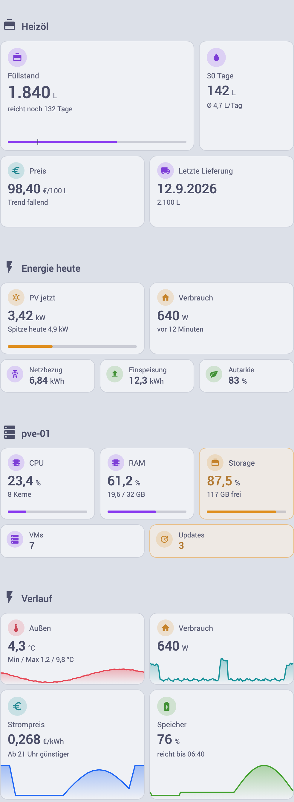
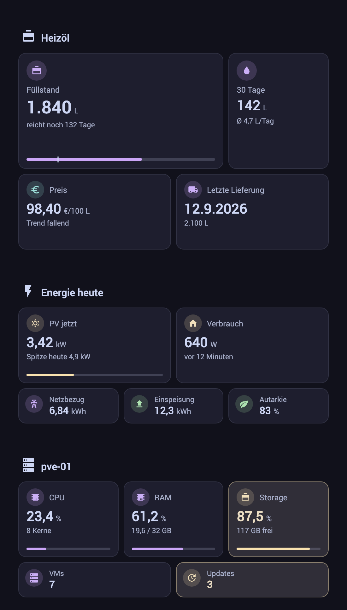
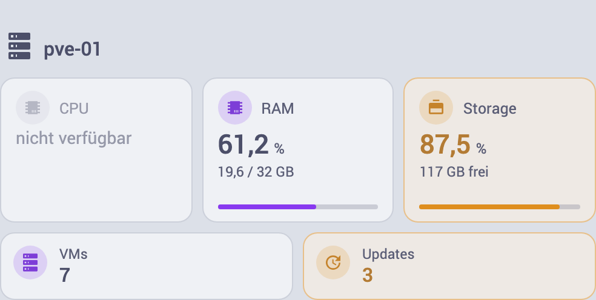
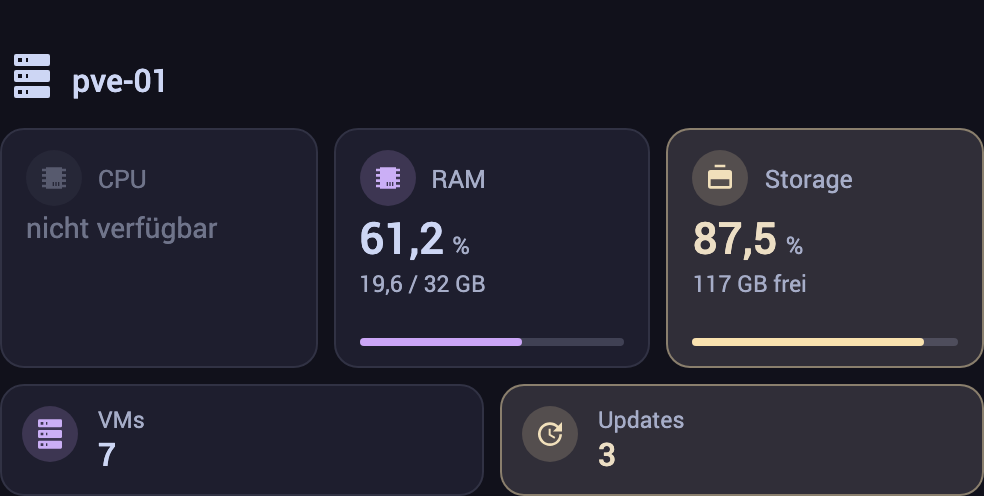
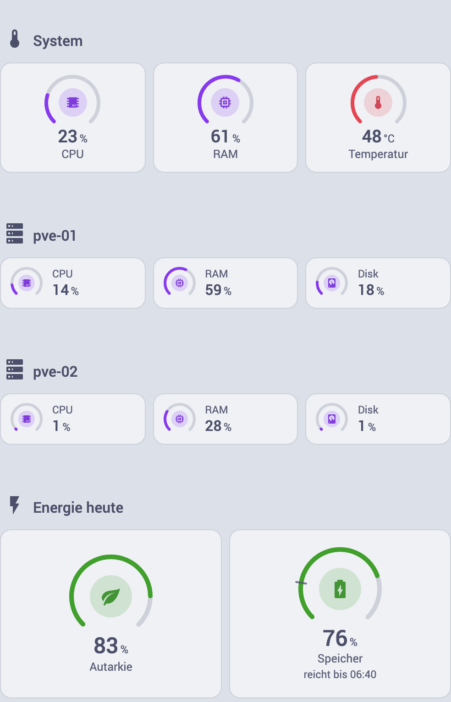
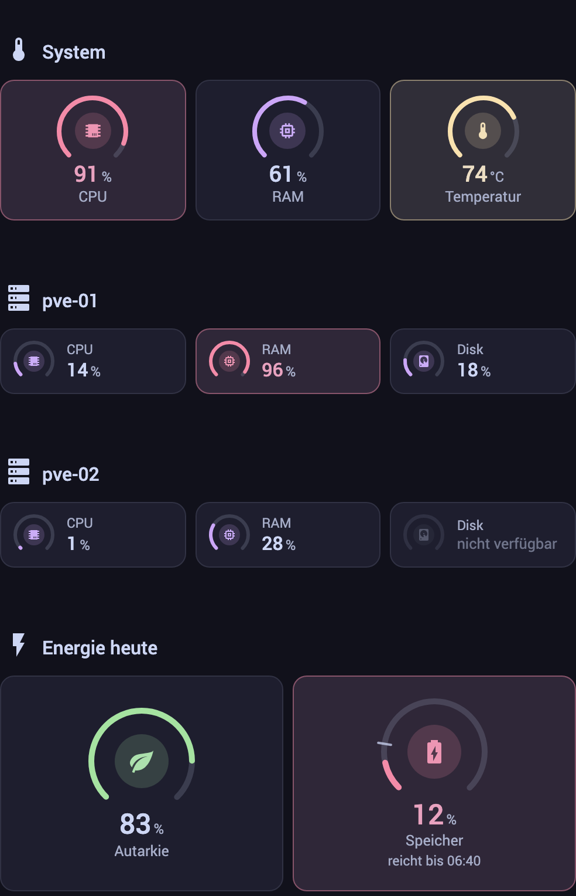

# Cards Kit

[](https://my.home-assistant.io/redirect/marketplace_repository/?owner=hoentaex&repository=ha-cards-kit&category=plugin)
[](https://github.com/hoentaex/ha-cards-kit/releases/latest)
[](https://github.com/hoentaex/ha-cards-kit/actions/workflows/validate.yml)
[](https://github.com/hoentaex/ha-cards-kit/actions/workflows/hacs.yml)
[](LICENSE)

**[Deutsch](#deutsch) · [English](#english)**

| Hell / Light | Dunkel / Dark |
|---|---|
|  |  |

---

## Deutsch

Kleine Karten mit genau einer Aufgabe, alle in **einer** Datei: die **KPI-Kachel** und die **Bogen-Kachel**. Look
und Farben passen zu den Schwesterkarten
[Oil Overview](https://github.com/hoentaex/ha-oil-overview-card),
[Energy Overview](https://github.com/hoentaex/ha-energy-overview-card),
[Central Heating](https://github.com/hoentaex/ha-central-heating-card) und
[Tibber Battery](https://github.com/hoentaex/ha-tibber-battery-card).

> [!WARNING]
> **Privates Hobbyprojekt.** Die Karten sind für meine eigene Installation entstanden und werden in der Freizeit
> gepflegt. Es gibt keine Gewährleistung und keinen Support: **Die Nutzung erfolgt auf eigene Gefahr.**
> Die Karten lesen nur Zustände aus Home Assistant – sie schalten nichts.

### Installation

**Über den Marketplace:**

[](https://my.home-assistant.io/redirect/marketplace_repository/?owner=hoentaex&repository=ha-cards-kit&category=plugin)

oder von Hand: **Marketplace → ⋮ → Benutzerdefinierte Repositories** → `https://github.com/hoentaex/ha-cards-kit`,
Typ **Dashboard** → *Cards Kit* installieren → Browser neu laden.

**Manuell:** `ha-cards-kit.js` aus dem [letzten Release](https://github.com/hoentaex/ha-cards-kit/releases/latest)
nach `/config/www/` kopieren, unter **Einstellungen → Dashboards → ⋮ → Ressourcen** `/local/ha-cards-kit.js` als
**JavaScript-Modul** eintragen, Browser neu laden.

### KPI-Kachel (`custom:kpi-tile-card`)

Ein Wert als eine Karte: Icon, Name, der Wert groß, eine Unterzeile und ein Balken. Gedacht für die
**Abschnitte-Ansicht** (Sections):

- **Überschrift:** die Überschrift-Karte (Heading) von Home Assistant, mit Icon und Badges.
- **Größe und Position:** im Layout-Tab der Karte, Standard 4 von 12 Spalten × 2 Reihen.
- **Darstellung folgt der Höhe:** 1 Reihe kompakt (Icon links, nur der Wert), 2 Reihen Standard (Unterzeile und
  Balken), 3 Reihen groß (Icon oben).
- **Fehlende Werte:** Die Kachel bleibt stehen, ausgegraut mit „nicht verfügbar“, „unbekannt“ oder „Entity nicht
  gefunden“. So entsteht keine Lücke. Wer sie lieber ausblendet: Sichtbarkeits-Tab, Bedingung „Zustand ist nicht
  unavailable“ (dann rücken die folgenden Karten nach, am Ende einer Reihe kann eine Lücke bleiben).

In der Masonry-Ansicht ist jede Kachel so breit wie die Spalte; nebeneinander geht es dort mit einer Raster-Karte
(`grid`).

| Hell | Dunkel |
|---|---|
|  |  |

#### Optionen

| Option | Standard | Bedeutung |
|---|---|---|
| `entity` | – | Die Entity, deren Zustand gezeigt wird |
| `name` | Anzeigename | Beschriftung über dem Wert |
| `icon` | Icon der Entity | z. B. `mdi:storage-tank` |
| `unit` | Einheit der Entity | Nur die Anzeige. Umrechnen (W → kW) in den Entity-Einstellungen |
| `digits` | Anzeigegenauigkeit der Entity | Nachkommastellen |
| `color` | nach Geräteklasse | Farbname von Home Assistant (`orange`, `teal`, …) oder CSS-Farbe |
| `subline` | – | Text, oder `{ attribute }`, `{ entity }`, `{ last_changed: true }`, jeweils mit `prefix` / `suffix` |
| `bar` | – | `{ percent: true }` oder `{ min, max }`; dazu `marker`. `min`, `max`, `marker` auch als Entity |
| `warn`, `bad` | – | `{ above: x }` oder `{ below: x }`, `x` auch als Entity. Färbt die Kachel gelb bzw. rot |
| `tap_action` | `more-info` | Aktionen von Home Assistant |

```yaml
type: custom:kpi-tile-card
entity: sensor.heizoel_fuellstand
name: Füllstand
subline:
  attribute: reichweite_tage
  prefix: "reicht noch "
  suffix: " Tage"
bar:
  max: 3000
  marker: sensor.heizoel_reserve
warn: { below: 800 }
bad: { below: 500 }
grid_options:
  columns: 8
  rows: 3
```

### Bogen-Kachel (`custom:gauge-tile-card`)

Ein Wert als offener Bogen (270°, unten offen) mit dem Icon darin. Wie die KPI-Kachel eine Karte je Wert für die
Abschnitte-Ansicht; Farben, Schwellen, Tippen und fehlende Werte verhalten sich gleich.

- **Darstellung** (`layout`): **Normal** – Bogen mittig, Wert und Name darunter (Standard 4 × 2); ab 3 Reihen Höhe
  größerer Bogen und die Unterzeile. **Kompakt** – kleiner Bogen links, Name und Wert daneben (Standard 4 × 1).
- **Bereich:** Werte in % laufen von 0 bis 100. Für andere Einheiten `max` angeben (auch als Entity), dazu `min`.
- **Marker** (optional): ein Strich auf dem Bogen, z. B. Reserve oder Ziel. Ohne `marker` gibt es keinen.

| Hell | Dunkel |
|---|---|
|  |  |

| Option | Standard | Bedeutung |
|---|---|---|
| `entity` | – | Die Entity, deren Zustand gezeigt wird |
| `layout` | `normal` | `normal` oder `compact` |
| `name`, `icon`, `unit`, `digits`, `color` | aus der Entity | wie bei der KPI-Kachel |
| `icon_background` | `true` | Icon mit getöntem Kreis |
| `min`, `max` | 0, bei % 100 | Bereich des Bogens; `max` auch als Entity |
| `marker` | – | Strich auf dem Bogen (Zahl oder Entity) |
| `subline` | – | wie bei der KPI-Kachel; nur Normal ab 3 Reihen |
| `warn`, `bad` | – | `{ above: x }` oder `{ below: x }`, `x` auch als Entity |
| `tap_action` | `more-info` | Aktionen von Home Assistant |

```yaml
type: custom:gauge-tile-card
entity: sensor.speicher_soc
marker: sensor.speicher_reserve
subline:
  attribute: reichweite
  prefix: "reicht "
warn: { below: 30 }
bad: { below: 15 }
grid_options:
  columns: 6
  rows: 3
```

---

## English

Small single-purpose cards, all in **one** file: the **KPI tile** and the **gauge tile**. Its look and colors match
the sibling cards linked above.

> [!WARNING]
> **Private hobby project**, built for my own installation and maintained in spare time, without warranty or
> support: **use at your own risk.** The cards only read states – they never switch anything.

### Installation

**Via the Marketplace:**

[](https://my.home-assistant.io/redirect/marketplace_repository/?owner=hoentaex&repository=ha-cards-kit&category=plugin)

or by hand: **Marketplace → ⋮ → Custom repositories** → `https://github.com/hoentaex/ha-cards-kit`, type
**Dashboard** → install *Cards Kit* → reload the browser.

**Manually:** copy `ha-cards-kit.js` from the [latest release](https://github.com/hoentaex/ha-cards-kit/releases/latest)
to `/config/www/`, add `/local/ha-cards-kit.js` as a **JavaScript module** under **Settings → Dashboards → ⋮ →
Resources**, reload the browser.

### KPI tile (`custom:kpi-tile-card`)

One value as one card: icon, name, the value large, a sub line and a bar. Made for the **sections view**:

- **Heading:** Home Assistant's heading card, with icon and badges.
- **Size and position:** in the card's Layout tab, default 4 of 12 columns × 2 rows.
- **The look follows the height:** 1 row compact (icon left, value only), 2 rows standard (sub line and bar), 3 rows
  large (icon on top).
- **Missing values:** the tile stays in place, greyed out with "unavailable", "unknown" or "Entity not found", so
  there is no gap. To hide it instead, add the visibility condition "state is not unavailable" (the following cards
  move up; a gap can remain at the end of a row).

In the masonry view each tile is as wide as the column; use a `grid` card to put tiles side by side there.

The options are the ones in the German table above (`entity`, `name`, `icon`, `unit`, `digits`, `color`, `subline`,
`bar`, `warn`, `bad`, `tap_action`); the YAML example works as it is.

### Gauge tile (`custom:gauge-tile-card`)

One value as an open arc (270°, open at the bottom) with the icon inside; one card per value like the KPI tile,
with the same colors, thresholds, tap action and missing-value behaviour.

- **Layout** (`layout`): **normal** – arc centered, value and name below (default 4 × 2); from 3 rows a bigger arc
  and the sub line. **compact** – small arc left, name and value beside it (default 4 × 1).
- **Range:** values in % run from 0 to 100; for other units set `max` (also an entity) and `min`.
- **Marker** (optional): a line on the arc, e.g. a reserve or a target. No `marker`, no line.

Options: `entity`, `layout`, `name`, `icon`, `unit`, `digits`, `color`, `icon_background` (default `true`), `min`,
`max`, `marker`, `subline` (normal layout from 3 rows), `warn`, `bad`, `tap_action` – see the German table above.

## Development

```bash
npm install
npm run check        # lint, build, syntax check
npm test
npm run demo         # http://127.0.0.1:8777/demo/
npm run screenshots
```

A release is built when a tag `vX.Y.Z` matching `package.json` is pushed; the notes come from `CHANGELOG.md`.
